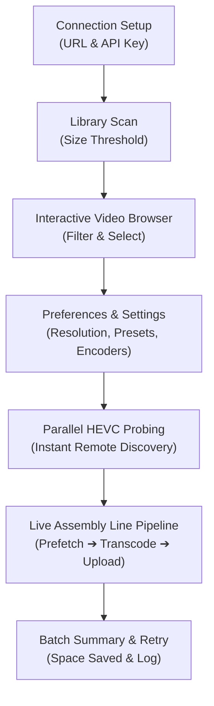

# 🎬 Immich Video Optimizer

A high-performance, interactive terminal client that reclaims gigabytes of disk space on your [Immich](https://immich.app/) server by re-encoding large original videos with local hardware-accelerated HEVC (H.265) compression—all while faithfully preserving 100% of camera metadata, shooting dates, and GPS coordinates.

---

## ⚡ Highlights

- **Blistering Fast Hardware Acceleration:**
  - **macOS:** Apple Silicon & Intel VideoToolbox (`hevc_videotoolbox`) — **~7.3x realtime, 220+ FPS**.
  - **Linux:** NVIDIA NVENC (`hevc_nvenc`), Intel VA-API (`hevc_vaapi`), or CPU (`libx265`).
  - **Windows:** NVIDIA NVENC, Intel QuickSync, or CPU fallback.
- **Assembly Line Pipelining:**
  - Decoupled **Prefetch Downloader** $\to$ **Transcoder Pool** $\to$ **Background Uploader**. Network downloads and GPU encoding run concurrently.
  - **Strictly Bounded Disk Usage:** Channels are capped at buffer capacity 1, guaranteeing at most **2 video files** are ever on local disk at once.
- **Zero-RAM Multipart Streaming:**
  - Streams multi-gigabyte video uploads directly from disk using `io.MultiReader` with exact `Content-Length`. Consumes $< 1\text{ KB}$ of RAM regardless of file size.
- **Parallel Remote HEVC Probing:**
  - Probes remote video headers via parallel HTTP Range requests (8-worker pool) to instantly detect and skip already-HEVC files in seconds without downloading payloads.
- **100% Metadata & Timeline Preservation:**
  - Uses ExifTool to replicate camera make/model, original shooting timestamps, and GPS coordinates.
  - Preserves Immich `fileCreatedAt`, `fileModifiedAt`, `deviceAssetId`, and original filenames in the server database.
- **Atomic State & Clean Pause/Resume:**
  - Press `q` anytime to pause. In-flight jobs are cleanly aborted, temporary files are purged, and interrupted videos remain pending in atomic `session.json`.
  - Resume anytime with full metadata and tracking album continuity.
- **Size Guard:**
  - Automatically compares output against source. If a transcoded video ends up larger than the original, replacement is skipped and the original is untouched.
- **Zero-Dependency Architecture:**
  - Single standalone binary. Automatically locates, extracts, or downloads standalone static binaries for `ffmpeg` and `exiftool` on demand.

---

## 📦 Installation

### Option 1: Pre-Compiled Binary (Recommended)

Download the latest release for your platform from the [Releases](https://github.com/dragos/immich-video-optimizer/releases) page:

| Platform | Architecture | Binary Archive |
|---|---|---|
| **macOS** | Apple Silicon (M1 / M2 / M3 / M4) | `immich-video-optimizer_darwin_arm64.tar.gz` |
| **macOS** | Intel x86_64 | `immich-video-optimizer_darwin_amd64.tar.gz` |
| **Linux** | 64-bit x86_64 | `immich-video-optimizer_linux_amd64.tar.gz` |
| **Linux** | ARM64 (Raspberry Pi 4/5, servers) | `immich-video-optimizer_linux_arm64.tar.gz` |
| **Windows** | 64-bit x86_64 | `immich-video-optimizer_windows_amd64.zip` |

#### macOS / Linux Quick Start:
```bash
# 1. Extract the downloaded archive (executable permission is preserved)
tar -xzf immich-video-optimizer_darwin_arm64.tar.gz

# 2. Run the application
./immich-video-optimizer
```

> **Note for macOS Users:** If macOS Gatekeeper displays a security warning because the binary was downloaded via browser, run:
> ```bash
> xattr -d com.apple.quarantine ./immich-video-optimizer
> ```
> Or right-click the binary in Finder $\to$ choose **Open** $\to$ click **Open Anyway**.

---

### Option 2: Build From Source

Requirements: Go 1.22+ and Git. System `ffmpeg` and `exiftool` are recommended in your `PATH` (e.g. `brew install ffmpeg exiftool` on macOS, or `sudo apt install ffmpeg libimage-exiftool-perl` on Linux).

```bash
git clone https://github.com/dragos/immich-video-optimizer.git
cd immich-video-optimizer
go build -o immich-video-optimizer .
./immich-video-optimizer
```

### CLI Flags

| Flag | Shorthand | Description |
|---|---|---|
| `--config` | `-c` | Open the interactive terminal configuration form to edit server URL and API key |

---

## 🚀 Usage & Workflow

When launched, the interactive Terminal UI (TUI) guides you through the optimization lifecycle:



### 1. Connection Setup
Enter your Immich server URL (e.g. `http://192.168.1.100:2283` or `https://immich.yourdomain.com`) and your **API Key** (created in Immich under *Account Settings $\to$ API Keys*). Credentials are saved securely to `~/.config/immich-video-optimizer/config.yaml`.

### 2. Video Browser & Selection
Review discovered videos that exceed your configured size threshold:
- **`[Space]`**: Toggle individual selection.
- **`[a]`**: Select all visible videos.
- **`[n]`**: Deselect all videos.
- **`[/]`**: Filter table by filename in real-time.
- **`[Enter]`**: Start optimization batch.
- **`[c]`**: Open Settings menu.

### 3. Settings & Preferences (`c`)
Customize processing options:
- **Target Resolution:** `Original` (preserves source dimensions), `4K`, `1440p`, `1080p`, or `720p` (never upscales).
- **Transcoding Preset:** `Ultrafast`, `Fast`, `Medium` (default), or `Slow`.
- **Size Guard:** Skips replacing the video on the server if the optimized output is larger than the original.
- **Skip HEVC Videos:** Fast pre-check that automatically skips videos already encoded in H.265.
- **Pipeline Prefetch:** Downloads the next candidate video in background while current video is transcoding.
- **Concurrent Encoders:** 1 (default, ideal for hardware encoders) or 2 (multi-GPU or high-core CPUs).
- **Size Threshold (MB):** Type any custom file size filter (e.g. `500` MB).
- **Logging Level:** `Info` (default) or `Debug`. Debug mode logs full FFmpeg and ExifTool command lines, stderr output, Immich API error bodies, and diagnostic traces to help troubleshoot transcoding failures.

### 4. Live Dashboard
Watch real-time multi-stage progress:
- **`⚙ Transcoding`**: Active file, resolution, file size, transcoding speed (e.g. `7.4x`), and FPS.
- **`↓ Prefetching`**: Next video currently downloading in the background.
- **`↑ Uploading`**: Completed video uploading back to Immich.
- **`[q]`**: Safely pause at any time without leaving corrupted files or losing progress.

---

## ⌨ Keyboard Shortcuts Cheatsheet

| Screen | Key | Action |
|---|---|---|
| **Global** | `Ctrl + C` | Force exit application |
| **Connection Setup** | `Tab` / `↓` / `↑` | Move between URL, API key, and submit button |
| | `Enter` | Test connection and continue |
| **Scan Prompt** | `Enter` / `s` | Start scanning Immich library for large videos |
| | `c` | Open Settings & Preferences |
| | `e` | Edit server connection details |
| | `q` / `Esc` | Exit application |
| **Video Browser** | `↑` / `↓` | Navigate table rows |
| | `Space` | Toggle selection for highlighted video |
| | `a` | Select all filtered videos |
| | `n` | Deselect all videos |
| | `/` | Open live search filter |
| | `Enter` | Start batch processing selected videos |
| | `c` | Open Settings & Preferences |
| | `s` | Rescan library |
| | `q` / `Esc` | Exit application |
| **Settings** | `↑` / `↓` (`k` / `j`) | Navigate setting rows |
| | `←` / `→` (`h` / `l`) | Change resolution, preset, or encoder count |
| | `Space` / `Enter` | Toggle option (Size Guard, Skip HEVC, Prefetch, Edit Threshold, Log Level) |
| | `Esc` / `q` | Save preferences & return to browser |
| **Live Dashboard** | `q` / `Esc` | **Pause optimization** (saves session state for later resume) |
| **Resume Prompt** | `r` | Resume previous paused session |
| | `s` | Discard session and start a new scan |
| | `c` | Clear session and exit |
| **Summary** | `r` | Retry failed videos |
| | `Enter` / `q` | Exit application |

---

## 🛡️ Safety & Data Protection

- **Non-Destructive Replacement:** The original video is deleted from Immich **only after** the replacement video has finished uploading and the server returns a valid asset ID.
- **Tracking Album:** Automatically tags processed assets in a dedicated in-progress album (`Immich-Optimizer-InProgress-<timestamp>`), allowing you to review uploads in Immich's web UI.
- **Crash-Resilient State:** Session states are written via write-and-rename (`session.json.tmp` $\to$ `session.json`). If power fails or the terminal is killed, session data cannot be corrupted.
- **Detailed Logging:** Diagnostic logs are stored in `~/.config/immich-video-optimizer/optimizer.log` (operational traces, FFmpeg and ExifTool commands and errors) and `failures.log` (dedicated failure ledger).

---

## 🧪 Development & Testing

Run unit tests across all packages:
```bash
go test -v ./config/... ./state/... ./engine/... ./tui/...
```

Build the native executable:
```bash
go build -o immich-video-optimizer .
```

---

## 📄 License

This project is licensed under the MIT License - see the [LICENSE](LICENSE) file for details.
