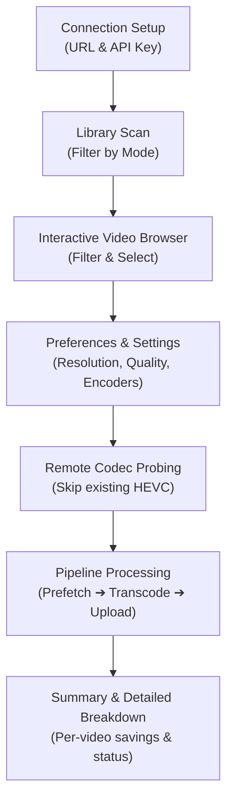

# 🎬 Immich Video Optimizer

A terminal client for [Immich](https://immich.app/) that reduces storage usage by re-encoding videos to HEVC (H.265) using local hardware acceleration, while preserving original metadata, creation dates, and GPS coordinates.

---

## Features

- **Hardware Acceleration:**
  - **macOS:** Apple Silicon & Intel VideoToolbox (`hevc_videotoolbox`).
  - **Linux:** NVIDIA NVENC (`hevc_nvenc`), Intel VA-API (`hevc_vaapi`), or CPU fallback (`libx265`).
  - **Windows:** NVIDIA NVENC (`hevc_nvenc`) or CPU fallback (`libx265`).
- **Pipelined Execution:**
  - Concurrent download prefetching, transcoding, and background uploading.
  - Strictly bounded disk usage: local storage holds at most 2 video files simultaneously.
- **Streaming Uploads:**
  - Streams multipart video uploads directly from disk using `io.MultiReader` with exact `Content-Length`, avoiding memory buffers for large files.
- **Remote Codec Probing:**
  - Checks remote video headers using HTTP range requests to detect and skip already-HEVC videos without downloading them.
- **Metadata Preservation:**
  - Uses ExifTool to replicate camera make/model, original shooting dates, and GPS coordinates.
  - Retains Immich database attributes including `fileCreatedAt`, `fileModifiedAt`, `deviceAssetId`, and original filenames.
- **Pause & Resume:**
  - Press `q` to pause at any point. Completed videos and pending items are saved atomically to `session.json` for later resume.
- **Size Guard:**
  - Verifies that the transcoded file is smaller than the original. If a re-encoded file is larger, replacement is skipped and the original is kept intact.
- **Adjustable Quality Control:**
  - 1–10 quality slider ranging from High Compression (~70–80% savings) to Visually Lossless (~15–20% savings). Maps automatically to standard CRF and Apple VideoToolbox quality scales.
- **Dry Run Estimation:**
  - Pre-flight preview inspecting video codecs and providing realistic, conservative storage savings estimates before processing.

---

## 📦 Installation

### Option 1: Pre-Compiled Binary (Recommended)

Download the latest release for your platform from the [Releases](https://github.com/dragosmiron/immich-video-optimizer/releases) page:

| Platform | Architecture | Binary Archive |
|---|---|---|
| **macOS** | Apple Silicon (M1 / M2 / M3 / M4) | `immich-video-optimizer_darwin_arm64.tar.gz` |
| **macOS** | Intel x86_64 | `immich-video-optimizer_darwin_amd64.tar.gz` |
| **Linux** | 64-bit x86_64 | `immich-video-optimizer_linux_amd64.tar.gz` |
| **Linux** | ARM64 (Raspberry Pi 4/5, servers) | `immich-video-optimizer_linux_arm64.tar.gz` |
| **Windows** | 64-bit x86_64 | `immich-video-optimizer_windows_amd64.zip` |

#### macOS / Linux Quick Start:
```bash
# 1. Extract the downloaded archive
tar -xzf immich-video-optimizer_darwin_arm64.tar.gz

# 2. Run the application
./immich-video-optimizer
```

> **Note for macOS:** If Gatekeeper blocks the downloaded binary, remove the quarantine attribute:
> ```bash
> xattr -d com.apple.quarantine ./immich-video-optimizer
> ```
> Or right-click the binary in Finder $\to$ choose **Open** $\to$ click **Open Anyway**.

#### Windows Quick Start:
1. Install prerequisites using **Winget**:
   ```powershell
   winget install Gyan.FFmpeg PhilHarvey.ExifTool
   ```
   *(Or using Scoop: `scoop install ffmpeg exiftool` or Chocolatey: `choco install ffmpeg exiftool`)*

2. Extract `immich-video-optimizer_windows_amd64.zip` and run the binary in **Windows Terminal** or PowerShell:
   ```powershell
   .\immich-video-optimizer.exe
   ```

---

### Option 2: Build From Source

Requirements: **Go 1.24+**, Git, `ffmpeg`, and `exiftool` in your `PATH`:
- **macOS:** `brew install ffmpeg exiftool`
- **Linux (Debian/Ubuntu):** `sudo apt update && sudo apt install -y ffmpeg libimage-exiftool-perl`
- **Windows:** `winget install Gyan.FFmpeg PhilHarvey.ExifTool`

```bash
git clone https://github.com/dragosmiron/immich-video-optimizer.git
cd immich-video-optimizer
go build -o immich-video-optimizer .
./immich-video-optimizer
```

### CLI Flags

| Flag | Shorthand | Description |
|---|---|---|
| `--config` | `-c` | Open interactive terminal configuration form to edit server URL and API key |

---

## 🚀 Usage & Workflow

The terminal interface guides you through the process:



### 1. Connection Setup
Enter your Immich server URL (e.g. `http://192.168.1.100:2283` or `https://immich.example.com`) and your **API Key** (created in Immich under *Account Settings $\to$ API Keys*). Credentials are saved to `~/.config/immich-video-optimizer/config.yaml`.

### 2. Video Browser & Selection
Review discovered videos exceeding your configured threshold (`MB/min`, `Total MB`, or all videos if `Disabled`):
- **`[Space]`**: Toggle selection for highlighted video.
- **`[a]`**: Select all visible videos.
- **`[n]`**: Deselect all videos.
- **`[/]`**: Filter table by filename in real-time.
- **`[d]`**: Dry Run preview (probe codecs and view estimated savings).
- **`[Enter]`**: Start optimization batch.
- **`[s]`**: Open Settings menu.
- **`[r]`**: Rescan library.

### 3. Settings & Preferences (`s`)
- **Target Resolution:** `Original` (default), `4K`, `1440p`, `1080p`, or `720p` (never upscales).
- **Video Quality:** 1–10 quality slider (default: `[6] Balanced`), balancing space savings with visual fidelity:
  - **Levels 1–3 (High Compression):** CRF 32–30, VideoToolbox 50–56. ~70–80% space savings, noticeable softening suitable for surveillance, dashcams, or casual recordings. (Level 1: Max Savings).
  - **Levels 4–6 (Balanced):** CRF 29–26, VideoToolbox 59–66. ~40–50% space savings with imperceptible quality loss. (Level 6: Default).
  - **Levels 7–8 (High Quality):** CRF 24–22, VideoToolbox 72–76. ~25–35% space savings, preserves fine film grain and high-motion details.
  - **Levels 9–10 (Visually Lossless):** CRF 20–18, VideoToolbox 80–85. ~15–20% space savings for archival preservation.
- **Size Guard:** `[✓] ON` (default checked) — skips replacement if the transcoded file is larger than the original.
- **Skip HEVC Videos:** `[✓] ON` (default checked) — automatically detects and skips videos already encoded in H.265.
- **Pipeline Prefetch:** `[✓] ON` (default checked) — downloads the next video in background while the current video transcodes.
- **Concurrent Encoders:** `1` (default, recommended for hardware encoders) or `2`.
- **Threshold Mode:** Dedicated 3-option filter toggle (`MB/min`, `Total MB`, `Disabled`):
  - `MB/min` (default): Bitrate density filtering (e.g. `100 MB/min`). Ensures short high-bitrate clips are caught while long lean files are bypassed.
  - `Total MB`: Flat file size threshold (e.g. `500 MB`). Filters strictly by total video file size.
  - `Disabled`: Includes all video assets in scans without threshold filtering.
- **Threshold Value:** Typeable value used by the active mode (`100 MB/min`, `500 MB`, or `Disabled (All videos scanned)`). Press `[Enter]` to edit when enabled.
- **Logging Level:** `Info` (default) or `Debug` (logs FFmpeg/ExifTool command arguments and stderr).
- **Network Retries:** Automatic retry count with exponential backoff on transient network drops (`0` to `5`, default `2`).

### 4. Live Dashboard
- **`⚙ Transcoding`**: Active file, resolution, file size, encoding speed, and FPS.
- **`↓ Prefetching`**: Next video downloading in the background.
- **`↑ Uploading`**: Completed video uploading to Immich.
- **`[q]`**: Safely pause at any time; temporary files are deleted and progress is saved.

### 5. Summary & Detailed Breakdown
Upon completion, the summary view displays:
- Counts for transcoded, skipped, and failed videos.
- Total disk space saved.
- Per-video breakdown showing original size $\to$ new size, bytes saved, and reduction percentage for each transcoded video.
- Skip reasons for untouched videos and failure categories.

---

## 🗂️ What to Do with the Tracking Album

Before optimization begins, queued videos are automatically added to a dedicated tracking album on your Immich server named:

```
Immich-Optimizer-InProgress-<YYYYMMDD-HHMMSS>
```

As each video is transcoded, its optimized replacement is uploaded and added to this album, while the original asset is cleanly removed.

During **Dry Run**, an inspection album is also created with the videos that will be processed:
```
Immich-Optimizer-DryRun-<YYYYMMDD-HHMMSS>
```
You can open Immich to review the queued videos before starting. This dry-run album is automatically removed when you start optimization or run another dry run.

### Important Details:
1. **Only Queued & Transcoded Videos Are Added:** Videos that are skipped (e.g. already HEVC, or skipped by Size Guard) are never added to this album.
2. **Review Playback:** Open this album in the Immich web or mobile app during or after the process to inspect the queued and newly uploaded videos.
3. **Delete the Album When Done:** Once you have verified that the transcoded videos play properly, **delete the album in Immich**.
   > **Note:** In Immich, deleting an album deletes **only the album container**. It does **not** delete the video assets inside it.

---

## ⌨ Keyboard Shortcuts

| Screen | Key | Action |
|---|---|---|
| **Global** | `Ctrl + C` | Force exit application |
| **Connection Setup** | `Tab` / `↓` / `↑` | Move between URL, API key, and submit button |
| | `Enter` | Test connection and proceed |
| **Scan Prompt** | `Enter` | Start library scan |
| | `s` | Open Settings |
| | `e` | Edit connection settings |
| | `q` / `Esc` | Exit application |
| **Video Browser** | `↑` / `↓` | Navigate rows |
| | `Space` | Toggle selection for highlighted video |
| | `a` | Select all filtered videos |
| | `n` | Deselect all videos |
| | `/` | Filter by filename |
| | `d` | Dry Run preview |
| | `Enter` | Start optimization |
| | `s` | Open Settings |
| | `r` | Rescan library |
| | `q` / `Esc` | Exit application |
| **Dry Run Preview** | `Enter` | Start optimization batch |
| | `s` | Open Settings |
| | `q` / `Esc` / `b` | Return to browser |
| **Settings** | `↑` / `↓` (`k` / `j`) | Navigate options |
| | `←` / `→` (`h` / `l`) | Change values |
| | `Space` / `Enter` | Toggle option / edit threshold |
| | `Esc` / `q` | Save and return |
| **Live Dashboard** | `q` / `Esc` | Pause optimization and save session |
| **Resume Prompt** | `r` | Resume paused session |
| | `s` | Discard session and scan anew |
| | `c` | Clear session and exit |
| **Summary** | `r` | Retry failed videos |
| | `Enter` / `q` | Exit application |

---

## 🛡️ Safety & Data Protection

- **Safe Replacement Order:** The original asset on Immich is deleted only after the replacement asset has successfully uploaded and returned a valid, distinct asset ID.
- **Atomic Session Persistence:** State is written using atomic file renames (`session.json.tmp` $\to$ `session.json`). Interrupted sessions can be resumed without duplicate uploads.
- **Logging:** Operational traces and errors are logged to `~/.config/immich-video-optimizer/optimizer.log`.

---

## 🧪 Development & Testing

Run the test suite:
```bash
go test -v ./...
go vet ./...
```

Build the native executable:
```bash
go build -o immich-video-optimizer .
```

---

## 📄 License

This project is licensed under the [GNU Affero General Public License v3.0 (AGPL-3.0)](LICENSE).
